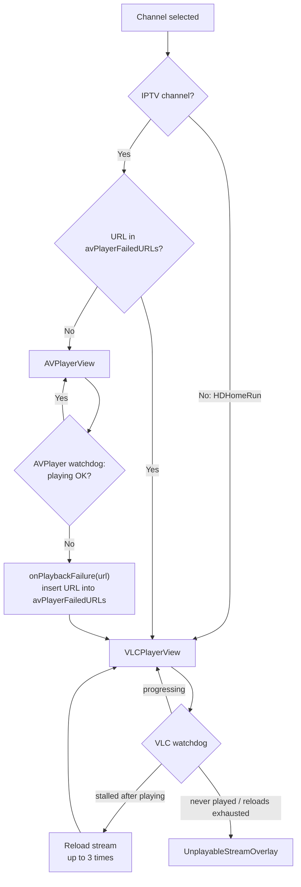
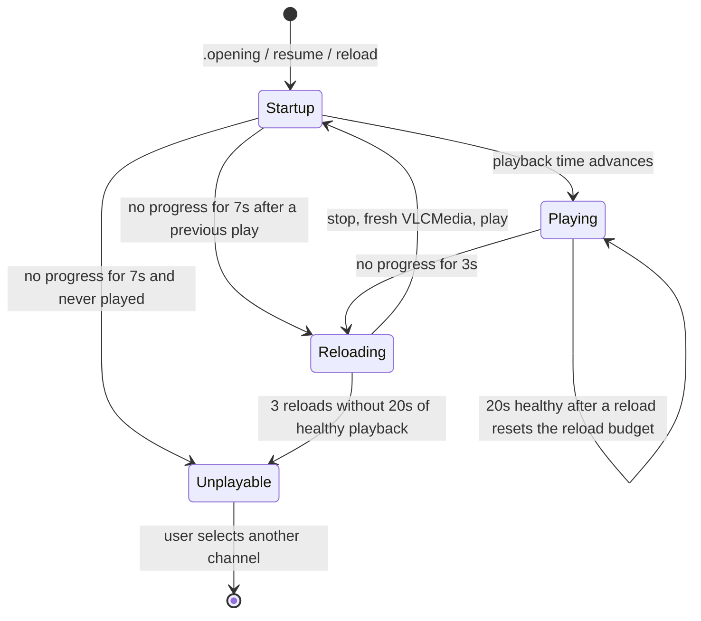

# Heck Yeah TV — Media Playback (UnifiedPlayerView, Discontinuities & Watchdogs)

Date drafted: November 24, 2026

Source: `HeckYeahTV/Source/UserInterface/MediaPlayerView`

## Summary

Heck Yeah TV plays two kinds of streams:

- **HDHomeRun** tuner channels: raw MPEG-TS over HTTP.
- **IPTV** channels: mostly HLS (`.m3u8`), many with server-side ad insertion (e.g. PlutoTV).

No single player handles both well, so `UnifiedPlayerView` picks a player per channel:

| Channel source | Player | Fallback |
|---|---|---|
| HDHomeRun | VLC | — (VLC watchdog reloads, then shows the unplayable overlay) |
| IPTV | AVPlayer | VLC, if AVPlayer fails, never starts, stalls, or plays audio with no video |

Both players are guarded by a `Watchdog` that polls playback once per second:

- The **AVPlayer watchdog** decides when to give up on AVPlayer and fall back to VLC.
- The **VLC watchdog** reloads frozen streams and, as the last resort, marks a stream unplayable.

## The Problem: Ad-Break Discontinuities

### Symptom

While watching a PlutoTV channel (e.g. `https://jmp2.uk/plu-5ca525b650be2571e3943c63.m3u8`) in VLC, the picture froze when a commercial break started. About 7 seconds later the old watchdog marked the stream unplayable. Changing to another channel and back fixed it every time.

### Root Cause

Found with libVLC debug logging (VLC 3.0.23):

1. PlutoTV serves HLS with **separate renditions**: one video playlist, two audio playlists (English and English Audio-Description) and a WebVTT subtitle playlist.
2. Ads are stitched in on the server. Each ad boundary is an `#EXT-X-DISCONTINUITY`: timestamps reset and the codec parameters may change.
3. At each boundary VLC 3's adaptive (HLS) demuxer logs `Ending demuxer stream. [discontinuity]` and restarts. With separate renditions it frequently never resumes: the demuxer position (`cur` in `cached.i_time` log lines) **freezes**, even though VLC keeps refreshing the playlists and downloading new segments.
4. VLC does not report an error. It stays in `.buffering`/`.playing`, and `mediaPlayerTimeChanged` keeps firing with an unchanged time.

Reloading the stream (a fresh `VLCMedia`) always recovers, because it starts a new demuxer at the live edge. That is exactly what the manual channel switch did.

### What Did Not Fix It

- **VLC media options.** The existing discontinuity-related options (`no-ts-trust-pcr`, `clock-jitter`, etc.) don't prevent the freeze.
- **Software decoding.** The first logs showed `VT-DS err=-12906` (VideoToolbox could not create a decoder), which pointed at the decoder. Forcing avcodec (`forceSoftwareDecode`, `"codec": "avcodec,all"`) removed those errors, but the freezes continued. The decoder was not the cause.
- **`avcodec-debug`.** Not used: the stall is in the demuxer/clock, upstream of the decoder, and the output is extremely noisy.

### The Fix

- **IPTV plays in AVPlayer first.** AVFoundation handles HLS discontinuities and separate renditions natively; PlutoTV ad breaks play seamlessly.
- **VLC stays as the fallback** for IPTV streams AVPlayer can't play, and for all HDHomeRun channels.
- **The VLC watchdog** detects a frozen stream within about 3 seconds and reloads it, so streams that do end up in VLC recover automatically.

## Why Two Players

| | AVPlayer | VLC (TVVLCKit / MobileVLCKit / VLCKit 3.0.x) |
|---|---|---|
| HLS ad insertion / discontinuities | Seamless | Freezes; needs a reload |
| Separate audio/subtitle renditions | Native media selection | Supported, but fragile at discontinuities |
| Raw MPEG-TS over HTTP (HDHomeRun) | Not supported | Supported |
| Format/codec coverage | HLS and Apple-supported codecs only | Very broad |
| Decoding | Hardware (VideoToolbox) | Software (when `forceSoftwareDecode` is on) |
| Volume range | 0–100% | 0–200% (amplification) |

AVPlayer earlier had stall problems with some IPTV streams, which is why VLC had been the only player. The AVPlayer watchdog now catches those cases and hands the stream to VLC instead of leaving it stuck.

## Player Selection Flow

- `avPlayerFailedURLs` is `@State` in `UnifiedPlayerView`. A stream that failed in AVPlayer stays on VLC for the rest of the app session; it is not persisted across launches.
- `VLCPlayerView` also covers "no channel selected" (VLC handles a `nil` channel by stopping).

## AVPlayer Watchdog (`AVPlaybackController`)

AVPlayer rarely reports failure for live streams it can't really play: it may wait forever, stall, or play audio with no video. `checkPlayback()` runs once per second and calls `onPlaybackFailure` (once per load) when any rule trips:

| Rule | Threshold | Typical cause |
|---|---|---|
| `AVPlayerItem.status == .failed` | Immediate | Unsupported format, network/HTTP error |
| Playback did not start | `startupTimeout` = 10s | Stream never becomes playable |
| No progress after starting | `stallTimeout` = 6s | Mid-stream stall (AVPlayer re-buffers short hiccups itself) |
| Audio plays but no video frame is displayed | `videoStartTimeout` = 5s after start | Video can't be decoded (seen on the tvOS Simulator: `VT-DS err=-8969`, audio only) |

Notes:

- **Progress** means `timeControlStatus == .playing` and `currentTime()` changed since the last check.
- **Video check:** it uses `AVPlayerLayer.isReadyForDisplay`, so it only applies when the item has a video track. Audio-only streams pass.
- **Polling instead of KVO:** this keeps all state on the main actor.
- **Overlay:** AVPlayer never shows the unplayable overlay itself. VLC gets the stream and its watchdog makes the final call.

## VLC Watchdog (`VLCPlayerRepresentable.Coordinator`)

| Item | Value | Why |
|---|---|---|
| Progress signal | `mediaPlayer.time` actually changes | VLC keeps firing `mediaPlayerTimeChanged` while frozen |
| `startupStallThreshold` | 7s | Opening, reloading and resuming take a few seconds |
| `midStreamStallThreshold` | 3s | Once playing, a 3s freeze is treated as a stuck demuxer |
| `maxStallRecoveries` | 3 | Prevents endless reload loops on a broken stream |
| `stallRecoveryResetInterval` | 20s | Ad breaks put a discontinuity every 30–60s, so each break needs a fresh budget |
| `isReloadingStream` | flag | Stops the transient `.stopped` event during a reload from shutting the watchdog down |

How it works:

- **Startup vs mid-stream:** `lastPlaybackTime == nil` marks startup. It is reset whenever monitoring (re)starts.
- **Unplayable:** sets `isStreamUnplayable`. `VLCPlayerView` shows `UnplayableStreamOverlay` and `updateView()` stops the player. Selecting a different channel clears the flag.
- **VLC errors:** VLC's own `.error` state is handled separately: up to `maxErrorRetries` (3) stop/play retries in `mediaPlayerStateChanged(_:)`.

## Related Fix: VLC Audio Track Selection

VLC audio track "indexes" are elementary stream (ES) ids that belong to one `VLCMedia` instance. Two bugs caused wrong-track or silent audio after reloads and channel changes:

1. **Stale ids.** The previous media's track id was applied to the new media. That selected the wrong rendition (e.g. Audio-Description) or a track that didn't exist.
2. **Late audio.** Streams with a separate audio rendition expose their audio a few seconds after `.playing`. A single lookup found 0 tracks and set the selection to `-1`, which VLC treats as **Disable**, turning the audio off.

The fix:

- **Reset on new media:** track state is cleared whenever new media loads.
- **Poll for late audio:** the lookup retries up to 5 times, 1.5s apart.
- **Keep VLC's default:** the selection starts as the track VLC already chose.
- **Validate before applying:** only a track that exists in the current media is applied, so `-1` or a stale id can't disable or misselect audio.

Details are in the "Audio track bug" Dev Note in `VLCPlayerRepresentable.swift`.

## Audio & Subtitle Menus

`PlayerOverlay` shows the audio-track and closed-caption menus whenever `appState.availableAudioTracks` / `availableSubtitleTracks` are non-empty. Both players publish into the same `AppStateProvider` properties:

| | VLC | AVPlayer |
|---|---|---|
| Track source | VLC ES ids | HLS media selection groups (`.audible`, `.legible`) |
| `TrackItem.index` | VLC ES id | Position in the option list |
| Subtitles offered | First subtitle track only (intentional) | All non-forced subtitle/caption options |
| "Off" | `-1` | `-1` (`select(nil, in: legibleGroup)`) |

The menus use an inline `Picker` so the selected item gets a native checkmark on iOS, tvOS and macOS. On macOS they also use `.menuIndicator(.hidden)` and a plain button style to match the round overlay buttons.

## Diagnostics

Useful console lines:

| Log line | Meaning |
|---|---|
| `AVPlayer: Playback started for …` | AVPlayer is progressing |
| `AVPlayer: Video rendering confirmed …` | First video frame displayed |
| `AVPlayer: Unable to play … (reason) - falling back to VLC` | AVPlayer watchdog gave up; VLC takes over |
| `VLC: No playback progress for Xs (threshold Ys) …` | VLC watchdog detected a freeze |
| `VLC: Playback stalled mid-stream … reloading attempt n of 3` | VLC reload in progress |
| `VLC: Playback healthy since last stall recovery - resetting recovery count` | Reload budget restored |
| `VLC: ERROR - No playback progress … marking stream as unplayable` | Final failure; overlay shown |
| `VLC: Detected N audio tracks (selected: X)` / `AVPlayer: Detected N audio tracks and M subtitle tracks …` | Track menus populated |

libVLC's own logging is enabled in DEBUG builds at `.error`. To investigate VLC stalls, temporarily switch `logger.level` to `.debug` in `VLCPlayerRepresentable.swift` and look for:

- `Ending demuxer stream. [discontinuity]` at the ad boundary.
- A `cur` value in `cached.i_time … cur …` lines that stops changing.
- `buffer too late (…): dropped` / `More than 11 late frames` (A/V clock drift after a discontinuity).

## Known Limitations & Future Work

- **`forceSoftwareDecode` is on.** It did not fix the stalls and costs CPU (notably for 4K on Apple TV). It's a candidate to turn off now that IPTV plays in AVPlayer.
- **The fallback lasts only one session.** A stream that fails in AVPlayer goes back to AVPlayer on the next launch.
- **AVPlayer volume is capped.** App volume settings above 100 play at normal level, because AVPlayer can't amplify.
- **The Simulator differs from devices.** The tvOS Simulator can't decode video for some streams in AVPlayer (BBC Top Gear), and the iOS device plays them fine. Fallback covers it, but test on devices.
- **SwiftVLC / libVLC 4 is untested.** libVLC 4 rewrote HLS discontinuity handling and may avoid the VLC freeze. The `SwiftVLC` package is in the project but believed not to work; the test is deferred.

## Source Files

| File | Role |
|---|---|
| `UnifiedPlayerView.swift` | Chooses AVPlayer or VLC per channel; tracks AVPlayer-failed URLs |
| `AVPlayerView.swift` | `AVPlayerView`, `AVPlaybackController` (watchdog, track selection), `AVPlayerLayer` view |
| `VLCPlayer/VLCPlayerView.swift` | VLC host view; unplayable overlay and switching indicator |
| `VLCPlayer/VLCPlayerRepresentable.swift` | VLC player, media options, VLC watchdog and reload, audio track handling |
| `Watchdog.swift` | Shared once-per-second polling actor used by both players |
| `Menu/Screens/PlayerOverlay/PlayerOverlay.swift` | Audio track and closed caption menus |
