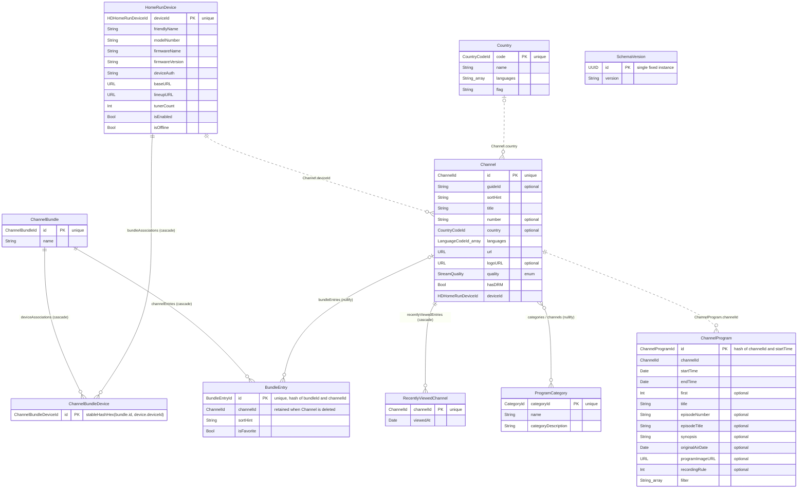

# Heck Yeah TV — SwiftData Schema

Date drafted: November 23, 2026

Current schema: `SchemaV1` (version 1.0.0), aliased as `HeckYeahSchema` in `SchemaCurrent.swift`.

Source: `HeckYeahTV/Source/Data/SwiftData/SwiftDataModels`

## Entity Relationship Diagram

Solid lines are SwiftData `@Relationship` properties. Dotted lines are logical links joined by identifier only (no `@Relationship`).

### Key: How to Read a Relationship Line

Every relationship in the diagram is written as `ModelA <left end><line><right end> ModelB`.

Take this line from the diagram as an example:

```text
ChannelBundle ||--o{ BundleEntry
```

Split it into its three pieces:

```text
ChannelBundle   ||        --         o{    BundleEntry
                 │         │          │
                 │         │          └── Right end: describes BundleEntry  → "zero or many"
                 │         └───────────── Line:      solid                  → SwiftData @Relationship
                 └─────────────────────── Left end:  describes ChannelBundle → "exactly one"
```

**Rule:** each end marker describes the model it is touching, not the model on the far side.

Read it out loud in both directions:

- One `ChannelBundle` has **zero or many** `BundleEntry` instances.
- Each `BundleEntry` belongs to **exactly one** `ChannelBundle`.

#### The Characters

Each end marker is two characters. Each character has one meaning:

```text
|   means  one      (drawn as a bar)
o   means  zero     (drawn as a circle)
{   means  many     (drawn as a crow's foot, on the right end)
}   means  many     (drawn as a crow's foot, on the left end)
```

The two characters are a minimum and a maximum. The character next to the line is the minimum; the character next to the model is the maximum.

```text
Left end   Right end   Minimum   Maximum   Meaning
--------   ---------   -------   -------   ------------
  ||          ||        one       one      exactly one
  |o          o|        zero      one      zero or one
  }o          o{        zero      many     zero or many
  }|          |{        one       many     one or many
```

#### The Line

```text
--   solid line    A SwiftData @Relationship property.
..   dotted line   A logical link: a stored identifier that matches another model's id, with no @Relationship.
```

#### All Relationship Lines in This Diagram, Read Out Loud

```text
ChannelBundle  ||--o{  BundleEntry            One bundle has zero or many entries. Each entry belongs to exactly one bundle.
Channel        |o--o{  BundleEntry            One channel has zero or many entries. Each entry points to zero or one channel
                                              (zero when the channel was removed from the catalog).
Channel        ||--o{  RecentlyViewedChannel  One channel has zero or many recently viewed records. Each record points to exactly one channel.
Channel        }o--o{  ProgramCategory        A channel has zero or many categories. A category has zero or many channels.
ChannelBundle  ||--o{  ChannelBundleDevice    One bundle has zero or many device links. Each link belongs to exactly one bundle.
HomeRunDevice  ||--o{  ChannelBundleDevice    One device has zero or many bundle links. Each link belongs to exactly one device.
HomeRunDevice  ||..o{  Channel                One device supplies zero or many channels (matched by Channel.deviceId).
Channel        ||..o{  ChannelProgram         One channel has zero or many programs (matched by ChannelProgram.channelId).
Country        |o..o{  Channel                One country has zero or many channels. Each channel has zero or one country
                                              (Channel.country is optional).
```



## Relationships

| From | Property | To | Cardinality | Delete Rule | Inverse |
|---|---|---|---|---|---|
| ChannelBundle | `channelEntries` | BundleEntry | 1 → many | cascade | `BundleEntry.channelBundle` |
| BundleEntry | `channelBundle` | ChannelBundle | many → 1 (required) | nullify | — |
| Channel | `bundleEntries` | BundleEntry | 1 → many | nullify | `BundleEntry.channel` |
| BundleEntry | `channel` | Channel | many → 0..1 | nullify | — |
| Channel | `recentlyViewedEntries` | RecentlyViewedChannel | 1 → many | cascade | `RecentlyViewedChannel.channel` |
| RecentlyViewedChannel | `channel` | Channel | many → 1 (required) | noAction | — |
| Channel | `categories` | ProgramCategory | many ↔ many | nullify | `ProgramCategory.channels` |
| ProgramCategory | `channels` | Channel | many ↔ many | nullify | `Channel.categories` |
| ChannelBundle | `deviceAssociations` | ChannelBundleDevice | 1 → many | cascade | `ChannelBundleDevice.bundle` |
| HomeRunDevice | `bundleAssociations` | ChannelBundleDevice | 1 → many | cascade | `ChannelBundleDevice.device` |
| ChannelBundleDevice | `bundle` | ChannelBundle | many → 1 (required) | nullify | `ChannelBundle.deviceAssociations` |
| ChannelBundleDevice | `device` | HomeRunDevice | many → 1 (required) | nullify | `HomeRunDevice.bundleAssociations` |

## Logical (Identifier-Only) Links

| From | Field | To | Notes |
|---|---|---|---|
| Channel | `deviceId` | HomeRunDevice.`deviceId` | Source device of the channel. |
| ChannelProgram | `channelId` | Channel.`id` | Guide schedule for a channel. |
| Channel | `country` | Country.`code` | ISO 3166-1 alpha-2 code. |
| BundleEntry | `channelId` | Channel.`id` | Mirrors `channel`; preserved so an orphaned entry can be re-linked when the channel returns to the catalog. |

## Unique Constraints and Indexes

| Model | Unique | Indexes |
|---|---|---|
| BundleEntry | `id` | `[sortHint, id]`, `[id]` |
| Channel | `id` | `[sortHint, id]`, `[id]`, `[deviceId]` |
| ChannelBundle | `id` | `[id]` |
| ChannelBundleDevice | `id` | `[id]` |
| ChannelProgram | `id` | `[id]`, `[channelId, startTime]`, `[endTime]` |
| Country | `code` | `[code]` |
| HomeRunDevice | `deviceId` | `[deviceId]`, `[isEnabled, deviceId]` |
| ProgramCategory | `categoryId` | `[categoryId]` |
| RecentlyViewedChannel | `channelId` | `[viewedAt]` |
| SchemaVersion | `id` | `[id]` |

## Value Types

`StreamQuality` (enum, stored on `Channel.quality`)

| Case | Meaning |
|---|---|
| `sd` | Standard Definition (≤ 480p) |
| `fhd` | Full HD (1080p) |
| `uhd4k` | Ultra HD 4K (~3840×2160) |
| `uhd8k` | Ultra HD 8K (~7680×4320) |
| `unknown` | Not reported / cannot be inferred |

Identifier type aliases (`SchemaCurrent.swift`): `BundleEntryId`, `ChannelBundleId`, `ChannelBundleDeviceId`, `ChannelId`, `ChannelProgramId`, `CountryCodeId`, `CategoryId`, `LanguageCodeId` are all `String`.

## Structural Notes

- **Channel** is the master catalog and the hub of the graph.
- **BundleEntry** is the join between `ChannelBundle` and `Channel` (many-to-many), carrying `isFavorite` and `sortHint`.
- **ChannelBundleDevice** is the join between `ChannelBundle` and `HomeRunDevice` (many-to-many). Deleting either side cascades to the join rows.
- **ChannelProgram**, **Country**, and the `Channel` → `HomeRunDevice` link are not modeled as relationships, so deletes do not propagate across them.
- **SchemaVersion** is a single-instance model holding the schema version string for inspecting the SQLite store directly.
